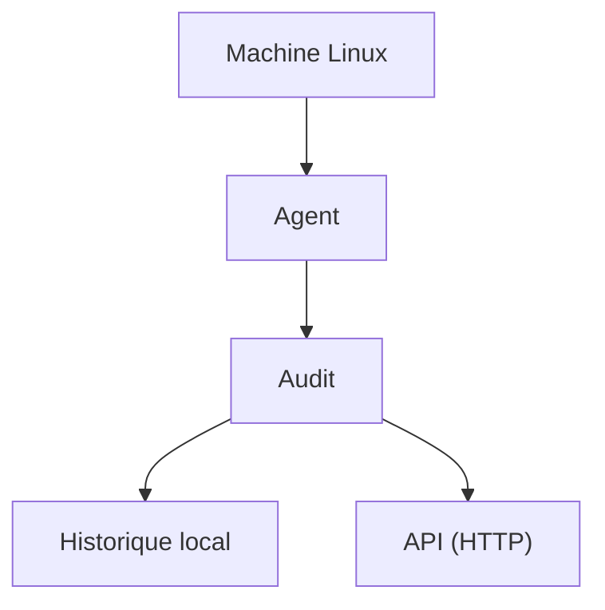

# Agent périodique

L’agent est un processus Python qui exécute le moteur à intervalle régulier. Il conserve un historique local et peut transmettre les rapports à l’API.



## Exécution unique

```bash
linux-hardener-agent --once
```

## Envoi à l’API

```bash
linux-hardener-agent --once --server http://127.0.0.1:8000/api/scans
```

## Mode périodique

```bash
linux-hardener-agent --interval 300 --server http://127.0.0.1:8000/api/scans
```

L’intervalle est exprimé en secondes.

## Rôle de l’agent

L’agent évite que l’API exécute directement des commandes système sur chaque hôte. Dans une architecture plus complète, il constitue la frontière entre la machine auditée et le serveur de supervision.

## Limites

La version 0.6.0 n’implémente ni authentification, ni certificats clients, ni gestion de flotte. L’agent doit être considéré comme une brique de laboratoire.
