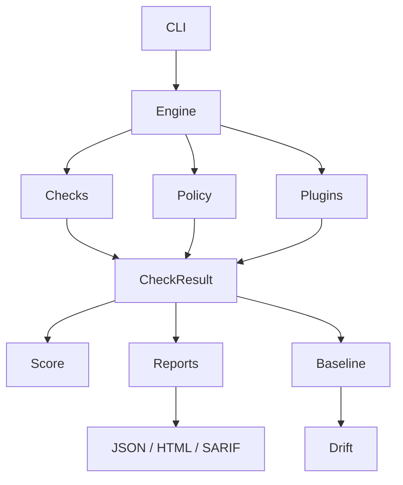
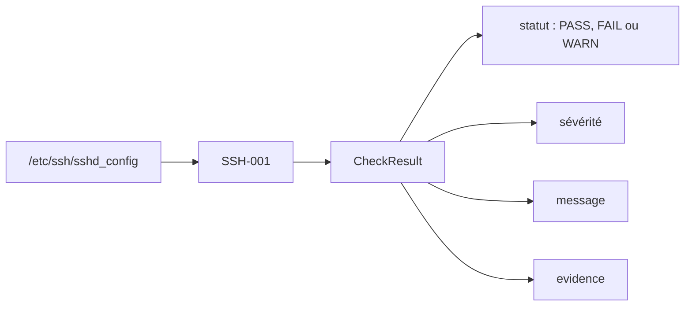
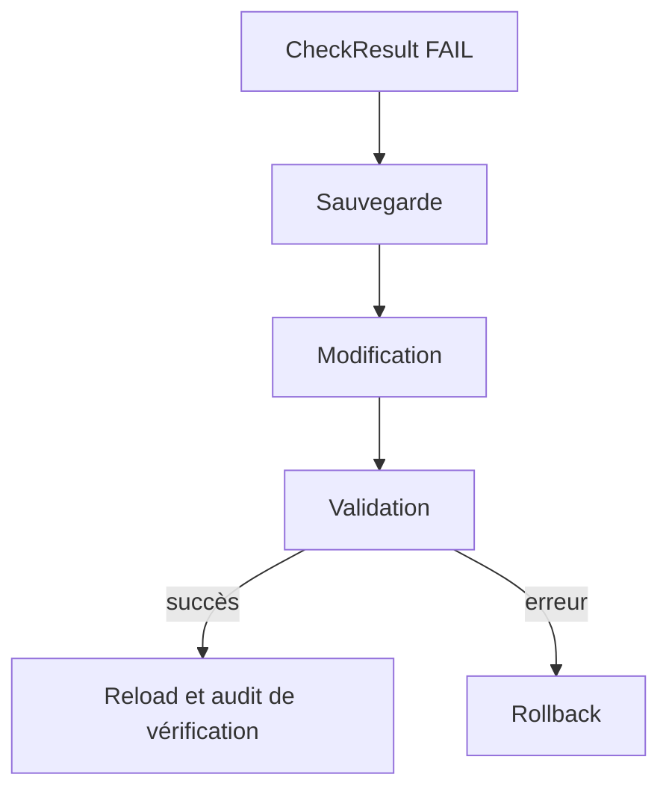

# Architecture

Un rapport de contrôle circule entre des composants distincts : collecte, décision, modification et affichage ne sont pas mélangés.

La remédiation et le rollback sont isolés du chemin d’audit.

## Séparation audit et remédiation

Un outil de hardening agit potentiellement sur des fichiers critiques. L’audit doit pouvoir s’exécuter seul, notamment en CI, sans effet sur la machine.

Le traitement d’un audit se déroule ainsi :

1. un contrôle lit une information système ;
2. il construit un `CheckResult` ;
3. le moteur rassemble les résultats ;
4. le score et le rapport sont calculés ;
5. le rapport peut être exporté ou comparé à une baseline.

La remédiation n’intervient qu’après cette étape.

## Modules

| Module | Rôle |
| --- | --- |
| `hardener/cli.py` | Interface en ligne de commande : `audit`, `remediate`, `baseline`, `drift`, `rollback`, `doctor`. |
| `hardener/engine.py` | Orchestration des contrôles actifs et construction du rapport. L’affichage est délégué aux reporters. |
| `hardener/checks/` | Contrôles en lecture seule, retournant un résultat normalisé. |
| `hardener/policy.py` | Sélection des contrôles actifs selon une policy YAML. |
| `hardener/remediation.py` | Modifications système autorisées, avec sauvegarde, validation et préparation du rollback. |
| `hardener/reporters.py` | Export du rapport en JSON, HTML ou SARIF. |
| `hardener/baseline.py` | Enregistrement d’un état de référence et comparaison (drift). |
| `hardener/api.py`, `hardener/db.py` | API FastAPI et historique SQLite. |
| `hardener/agent.py` | Exécution d’audits périodiques et transmission des rapports à l’API. |
| `hardener/plugins/` | Contrôles propres à un composant, ajoutés sans modifier le registre principal. |

## Exemple : le contrôle SSH-001

Si une remédiation est demandée pour un résultat `FAIL`, la séquence suivante s’applique :

