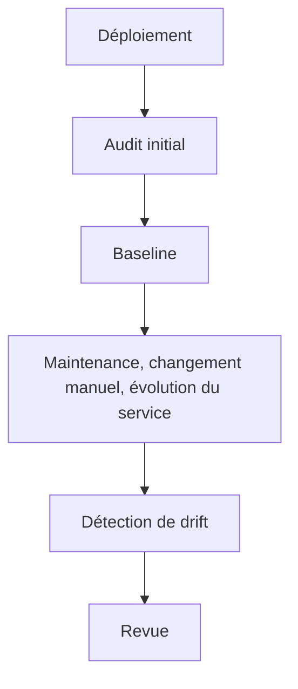

# Baseline et drift

L’audit et le drift répondent à deux questions différentes :

- **audit** : l’état courant respecte-t-il les règles ?
- **drift** : qu’est-ce qui a changé depuis l’état de référence ?

Cette distinction est utile sur un serveur qui doit rester stable dans le temps.

## Créer une baseline

Une fois obtenu un état validé comme référence :

```bash
sudo linux-hardener baseline --output baseline.json
```

Le fichier peut être conservé avec les autres artefacts du projet.

## Comparer l’état courant

```bash
sudo linux-hardener drift baseline.json
```

En l’absence de changement, la commande affiche :

```text
No drift detected.
```

Dans le cas contraire, elle liste les différences et retourne un code de sortie non nul, exploitable en CI.

## Cycle d’utilisation



## Cas d’usage

Créer une nouvelle baseline après :

- l’installation d’une machine ;
- une opération de hardening ;
- une migration ;
- une intervention d’administration ;
- une mise à jour importante de configuration.

## Limites

Le drift ne remplace pas l’audit. Un système peut rester conforme à une ancienne baseline tout en ne respectant plus une nouvelle policy. Les deux mécanismes sont complémentaires.
