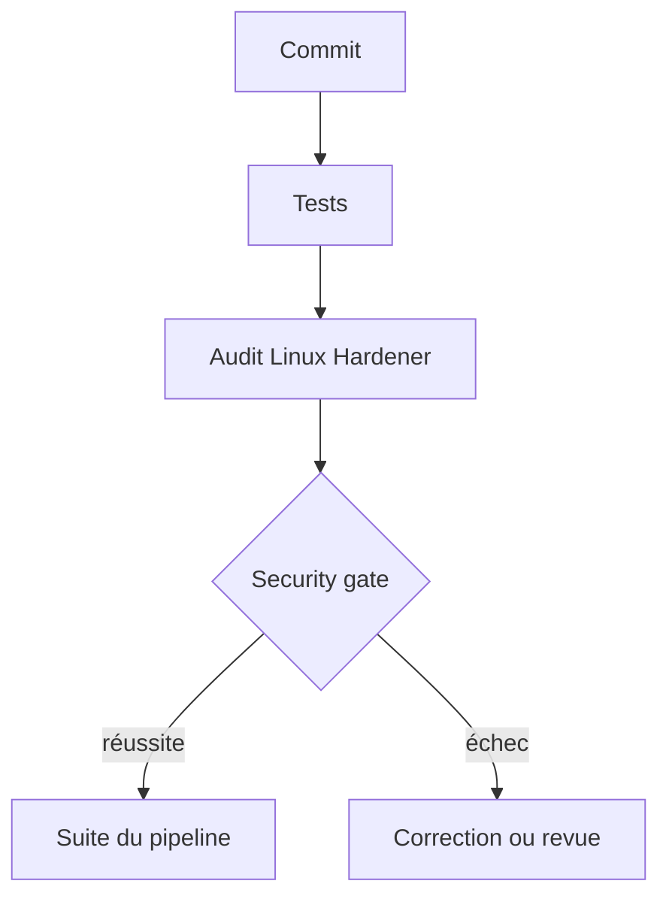

# Intégration CI/CD

Linux Hardener permet de déplacer une partie du contrôle de sécurité plus tôt dans le cycle de développement.



## Security gate local

```bash
linux-hardener audit --fail-on high
```

Le seuil définit la sévérité à partir de laquelle un `FAIL` fait échouer la commande.

## Exemple GitHub Actions

```yaml
name: Linux Security

on:
  push:
  pull_request:

jobs:
  hardening:
    runs-on: ubuntu-latest

    steps:
      - uses: actions/checkout@v4

      - name: Install
        run: |
          python3 -m pip install -r requirements.txt
          python3 -m pip install -e .

      - name: Tests
        run: pytest -q

      - name: Security gate
        run: linux-hardener audit --fail-on high

      - name: Reports
        run: |
          linux-hardener audit \
            --json report.json \
            --sarif report.sarif
```

## Seuil de sévérité plutôt que score

Le score agrège plusieurs contrôles. Un pipeline requiert une règle de décision explicite : un seuil de sévérité en fournit une, par exemple « aucun `FAIL` de niveau high ou critical n’est accepté ».
