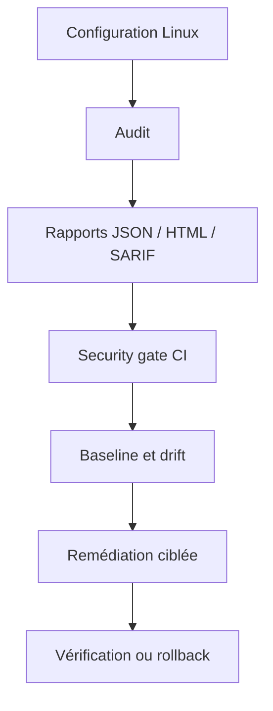

# Linux Hardener

Linux Hardener est un outil d’audit et de contrôle de conformité pour Linux. Il relève l’état d’une machine, le compare à une grille de règles, produit des rapports exploitables et propose, pour un sous-ensemble de règles, une remédiation encadrée.

Le projet couvre l’ensemble de la chaîne, de l’audit à la vérification :

## Objectifs

### Rendre l’état de sécurité observable

Les paramètres de sécurité d’un système sont dispersés : SSH, permissions, services, noyau, réseau, journalisation, comptes et règles `sudo`. Linux Hardener les regroupe dans une sortie homogène. Chaque résultat comporte un identifiant de contrôle, un statut, une sévérité et un message.

### Séparer l’audit de la modification

Un audit ne modifie pas la machine. Les contrôles lisent l’état du système et retournent un résultat. Les modifications sont isolées dans le moteur de remédiation, ce qui rend le comportement prévisible et plus simple à tester.

### Intégrer la sécurité à la chaîne CI/CD

Les résultats peuvent être exportés dans plusieurs formats et servir de critère de blocage dans un pipeline (security gate).

### Conserver un code lisible

L’architecture repose sur des fonctions courtes, des objets Python simples et des fichiers YAML. Le parcours complet d’un contrôle peut être suivi sans connaître de framework interne.

## Périmètre de la version 0.6.0

- configuration SSH ;
- permissions des fichiers sensibles ;
- paramètres `sysctl` ;
- présence d’un pare-feu ;
- état de certains services ;
- journalisation et `auditd` ;
- AppArmor et SELinux ;
- sockets réseau en écoute ;
- mises à jour de paquets Debian ;
- comptes UID 0 et règles `sudo` ;
- plugin Docker (première intégration) ;
- rapports JSON, HTML et SARIF ;
- baseline et détection de drift ;
- API et agent pour une architecture multi-composants.

## Hors périmètre

Linux Hardener n’est ni un scanner de vulnérabilités (CVE), ni un EDR, ni un SIEM, ni un outil d’administration de parc. Le score produit reflète la conformité à la grille du projet. Il permet de suivre l’évolution d’un système mais ne constitue pas une mesure du risque.

## Pour commencer

1. [Installation](./installation)
2. [Premier audit](./premier-audit)
3. [Architecture](./architecture)
4. [Contrôles](./controles)
5. [Remédiation](./remediation)
6. [Baseline et drift](./baseline-drift)
7. [Intégration CI/CD](./cicd)
8. [Docker Lab](./docker-lab)
