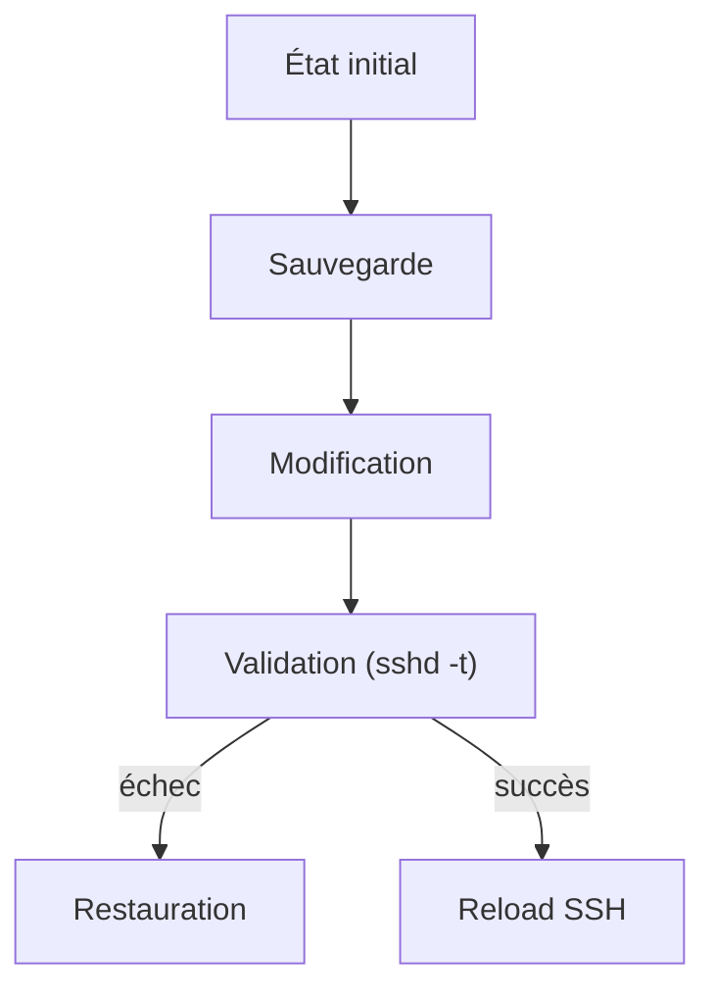

# Remédiation

La remédiation transforme un constat d’audit en modification du système. C’est la partie la plus sensible de l’outil.

:::warning
Ordre à respecter : audit, puis dry-run, puis modification réelle.
:::

## 1. Simuler les changements

```bash
sudo linux-hardener remediate --dry-run
sudo linux-hardener remediate --dry-run --only SSH-001 SSH-003
```

## 2. Principe transactionnel

Pour la configuration SSH, le moteur suit la séquence suivante :



Cette séquence évite de laisser en place un fichier de configuration invalide.

## Contrôles remédiables

La remédiation cible les contrôles SSH et `sysctl` disposant d’une règle de correction connue et d’une vérification après changement.

Le pare-feu et les mises à jour de paquets restent en audit uniquement : modifier le rôle réseau ou le niveau de patch d’un serveur nécessite un contexte métier que l’outil ne possède pas.

## Application

Sur une machine virtuelle de test :

```bash
sudo linux-hardener remediate
sudo linux-hardener audit
```

Après remédiation, les contrôles corrigés doivent passer de `FAIL` ou `WARN` à `PASS`.

## Précaution SSH

Ne pas tester une modification SSH sur une machine distante avec une seule session d’administration. Conserver une console de secours ou une seconde session ouverte.

## Périmètre de l’automatisation

Le niveau de hardening dépend du rôle de la machine : bastion, serveur web, base de données et poste de travail n’ont pas les mêmes besoins. L’outil automatise uniquement ce qui est bien spécifié et vérifiable, et laisse les décisions de contexte à l’administrateur.
